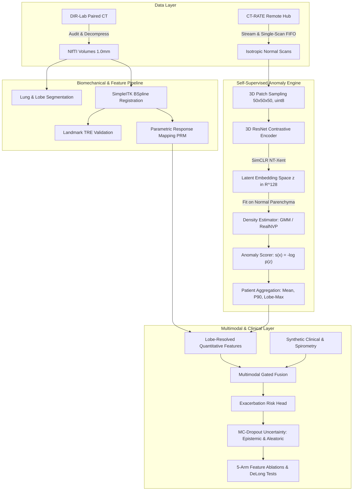

# Technical Architecture & Scientific Specification

## 1. System Overview & Core Paradigms

**COPD-Anomaly** is a self-supervised 3D anomaly detection and multimodal risk stratification framework for Chronic Obstructive Pulmonary Disease (COPD). It addresses key challenges in thoracic CT analysis:
1. **Unsupervised Phenotyping**: High-resolution 3D thoracic CT contains complex spatial patterns (emphysema, airway thickening, gas trapping, mosaic attenuation) that exceed the expressiveness of simple global density thresholds.
2. **Dense Normal Modeling**: By learning a rich feature representation of healthy lung parenchyma from thousands of normal patches, disease is quantified in an anomaly framework as negative log-likelihood deviations $s(x) = -\log p(f(x))$.
3. **Paired Biomechanics**: Deformable non-rigid registration aligns full-inspiration (iBHCT) and end-expiration (eBHCT) volumes, enabling voxel-wise Parametric Response Mapping (PRM) to separate irreversible parenchymal destruction (emphysema) from dynamic air trapping (functional small airway disease, fSAD).
4. **Spatial Gradients**: Five-lobe anatomical segmentation decomposes anomaly scores into upper-to-lower gradients, left-to-right asymmetries, and inter-lobar heterogeneity indices.

---

## 2. Mathematical Formulations & Tensor Contracts

### 2.1 Patch Normalization & Representation
- **Windowing**: Voxel intensity $I \in [-1024, 0]\text{ HU}$ is clipped and quantized to 8-bit unsigned integers:
  $$I_{\text{uint8}} = \text{round}\left( \frac{\text{clip}(I, -1024, 0) - (-1024)}{1024} \times 255 \right)$$
- **Tensor Input**: Each 3D patch has shape $(B, C, 50, 50, 50)$ with $C=1$ (insp only) or $C=2$ (insp + registered exp).
- **Float Conversion**: Normalized in memory to float32 $[0.0, 1.0]$ via $x = I_{\text{uint8}} / 255.0$.

### 2.2 3D Contrastive Encoder Architecture
- **Backbone**: 3D ResNet with initial $3 \times 3 \times 3$ Conv (filters=16 or 32, stride=1, padding=1), followed by 3 residual stages (downsampling by factor 2 at each stage):
  $$(B, C, 50, 50, 50) \xrightarrow{\text{stage 1}} (B, 32, 25, 25, 25) \xrightarrow{\text{stage 2}} (B, 64, 13, 13, 13) \xrightarrow{\text{stage 3}} (B, 128, 7, 7, 7)$$
- **Pooling & Embedding**: Adaptive average pooling $\to (B, 128) \to \text{Linear} \to \text{BN} \to \text{ReLU} \to z_{\text{emb}} \in \mathbb{R}^{B \times 128}$.
- **Projection Head**: 2-layer MLP producing $L_2$-normalized unit vectors $z_{\text{proj}} \in \mathbb{R}^{B \times 64}$:
  $$z_{\text{proj}} = \frac{g(z_{\text{emb}})}{\|g(z_{\text{emb}})\|_2}$$

### 2.3 NT-Xent Contrastive Objective
Given two stochastic augmentations $v_1, v_2$ of each patch in batch size $B$ (yielding $2B$ views):
$$\ell_{i, j} = -\log \frac{\exp(\text{sim}(z_i, z_j) / \tau)}{\sum_{k=1, k \ne i}^{2B} \exp(\text{sim}(z_i, z_k) / \tau)}$$
where $\text{sim}(u, v) = u^\top v$ and default temperature $\tau = 0.07$.

### 2.4 Normal Density Estimation & Scoring
1. **Gaussian Mixture Model (GMM)**:
   $$p(z) = \sum_{k=1}^K \pi_k \mathcal{N}(z \mid \mu_k, \Sigma_k)$$
   Fitted strictly on normal patches ($\text{LAA}_{-950} < 0.01$ from subjects with zero reported abnormalities).
2. **RealNVP Normalizing Flow**:
   Sequence of affine coupling layers with alternating binary masks $m \in \{0, 1\}^D$:
   $$y = m \odot x + (1 - m) \odot \left( x \odot \exp(s(m \odot x)) + t(m \odot x) \right)$$
   $$\log p(x) = \log p_0(z) + \sum_{l=1}^L \sum_{d=1}^D (1 - m_d) s_l(m \odot x)_d$$
3. **Patch Anomaly Score**:
   $$s(x) = -\log p(f(x))$$

### 2.5 Parametric Response Mapping (PRM)
Using co-registered pair $(I_{\text{insp}}, I_{\text{exp\_warped}})$:
- $\text{PRM}^{\text{norm}}$: $I_{\text{insp}} \ge -950\text{ HU}$ and $I_{\text{exp}} \ge -856\text{ HU}$
- $\text{PRM}^{\text{fSAD}}$: $I_{\text{insp}} \ge -950\text{ HU}$ and $I_{\text{exp}} < -856\text{ HU}$
- $\text{PRM}^{\text{emph}}$: $I_{\text{insp}} < -950\text{ HU}$ and $I_{\text{exp}} < -856\text{ HU}$
- $\text{PRM}^{\text{PD}}$: $I_{\text{insp}} \ge -700\text{ HU}$

---

## 3. Disjoint Patient Split Governance

| Split Name | Source | Volume Count (Lean) | Patient Isolation | Role |
|---|---|---|---|---|
| `dirlab_all` | DIR-Lab COPD | 20 (10 pairs) | Independent cohort | Registration TRE, PRM, lobe-level spatial analysis |
| `ctrate_train` | CT-RATE (Train) | 100 subjects | Zero overlap with val/test | Contrastive encoder pretraining; GMM/Flow normal fit |
| `ctrate_val` | CT-RATE (Train) | 30 subjects | Zero overlap with train/test | Threshold selection, GMM component $K$ tuning |
| `ctrate_test` | CT-RATE (Valid) | 70 subjects | Zero overlap with train/val | Proxy AUROC / AUPRC evaluation (evaluated once) |

---

## 4. Hardware Optimization & Cloud Execution Profile

- **Local Development**: Windows 11, local Python 3.11, CPU execution with fast mock modes for CI.
- **Kaggle / Colab GPU Profile**:
  - Precision: Automatic Mixed Precision (`torch.cuda.amp.autocast`).
  - Batch size: 32 patches per GPU step.
  - Streaming IO: Zero local disk accumulation via immediate temporary NIfTI deletion.
